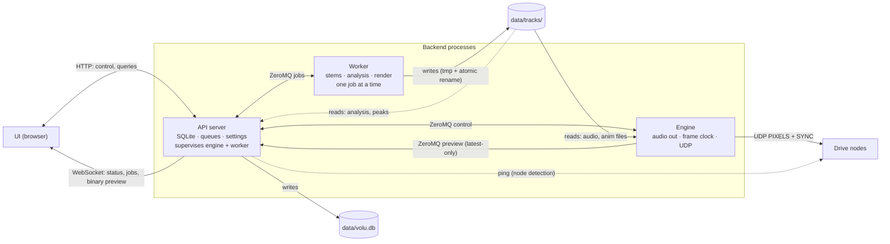
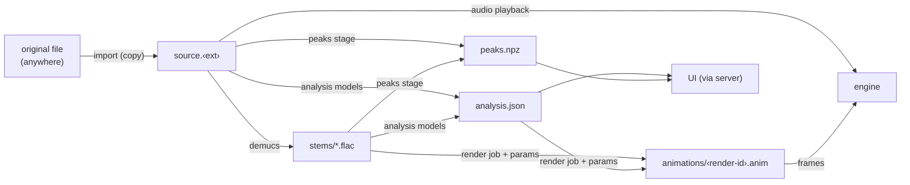

# Architecture (gen_system)

Status: **working draft.** This is the current state of the host software
architecture. It is expected to change as it is refined and during
development: update it in place when the design moves, and record settled,
non-obvious choices in `decisions/`. It overrides the "Recommended approach"
section of `gen_system/AGENTS.md` wherever the two differ.

Open questions are collected at the end; items marked *(proposed)* are the
current default until decided.

Related: `requirements.md`, `ui.md`, `generators.md`, `protocol.md`,
`decisions/0004-audio-analysis.md`, `decisions/0006-waveform-peaks.md`,
`decisions/0007-ipc-zeromq.md`, `decisions/0008-animation-file-format.md`,
`decisions/0009-audio-output-api.md`.

---

## Principles
- **Offline generation, dumb playback.** Audio → stems → analysis →
  animation file happens ahead of time and can be slow. Playback only reads
  files: no analysis or rendering in the hot path.
- **The audio clock is the master clock.** The frame index is derived from
  the audio device's playback position, never from wall-clock timers.
- **The UI is a remote control.** It sends commands and draws what the
  backend reports. A UI freeze, reload, or crash never affects audio or
  frames.
- **One writer per store.** Every file or database has exactly one process
  that writes it.
- **Real-time threads never block on anything** — no IPC, no file I/O, no
  waiting on other processes.

## Processes



| Process | Role | Writes | Never does |
|---|---|---|---|
| API server | Coordinator; the only holder of persistent state | SQLite; new track dirs on import | Timing, model inference |
| Engine | Plays audio, sends frames | nothing | DB access, HTTP, models |
| Worker | Runs GPU/batch jobs | `data/tracks/` (everything after import) | DB access, playback |

The UI talks only to the API server.

### API server
- FastAPI + uvicorn, one asyncio loop. Entry point (`volu serve`); spawns
  the engine and the worker, and respawns them if they die.
- **SQLite** holds: tracks (key, name, original path, analysis status, BPM), versions
  (draft/saved, track params, plan, generator version, geometry hash, file
  path),
  presets, settings, the play queue, and the job queue. The server is its
  only writer.
- **Imports tracks** (see Storage layout → Import): copies uploaded or
  scanned audio into a new track directory, then hands it to the worker.
- Loads and validates the active display config (no overlaps, full
  coverage, ≤ 64 strips per node) and computes the **geometry hash**. It
  passes the config path and hash to the engine and worker, so all three
  agree on geometry.
- **Node detection:** pings each node's configured IP and pushes the online
  set to the engine. Moves into the engine once protocol type 3 (status)
  exists.
- **UI API:** HTTP for library, analysis, peaks, settings, versions,
  presets, generator parameter schemas; one WebSocket for live state
  (engine status, job progress, node status, binary preview frames).
  Preview frames are latest-only: a slow browser drops frames, never queues
  them.
- **Engine state is a function of server state.** On every engine
  (re)connect the server sends a full `configure`; the engine keeps no
  persistent state of its own.
- Owns the **play queue** and **job queue** and their policies (priority,
  preloading the next track, cleanup of unreferenced animation files).

### Engine
The real-time process, kept as small as possible. It receives file paths
and commands, plays audio, and sends frames. Raised process priority; 1 ms
timer resolution on Windows.

**Threads**

| Thread | Does | Never does |
|---|---|---|
| Audio callback (PortAudio via `sounddevice`) | Copies samples from the preloaded buffer; records `(dac_time, sample_index)` per buffer; switches current → next at the exact sample (gapless) | I/O, allocation, long locks |
| Frame | Each frame: read clock → pick frame index → take it from a decoded chunk → packetize → PIXELS to every node → one SYNC broadcast; write the preview frame (picked with `preview_offset`) to the preview slot | IPC, file loading |
| Loader | Decodes audio and opens animation files into the `current` / `next` slots | Anything timed |
| Prefetch | Keeps the playhead's animation chunk and the next one decoded (decision 0008); after a seek or `swap_anim`, decodes the new playhead's chunk first | Anything timed |
| Control | IPC with the server; publishes status (~20 Hz) and preview (preview FPS setting, ≤ `max_fps`) from shared slots | Block the real-time threads |

Real-time threads share state with the control thread only through small
lock-guarded slots or atomic reference swaps.

**Clock.** The frame thread reads `stream.time`, the same time base as
PortAudio's DAC timestamps:

```
heard_pos(now) = sample_index + (now − dac_time) × sr      # sample at the speaker now
frame          = floor((heard_pos / sr + display_offset) × max_fps)
```

- `display_offset` is the **A/V sync offset**, a user setting in ms
  (positive = lights earlier). It covers audio output latency, network and
  latch time, and anything else that misaligns sound and light. Set by the
  calibration flash + click, and adjustable by hand from the UI at any time
  (`ui.md` → Sync).
  - **Applied live:** a change goes out in `configure` and takes effect at
    the next frame, with no reload or playback interruption. The jump is at
    most the change itself; nudges are small.
  - **Stored per audio device + output mode** (e.g. WASAPI shared vs.
    exclusive), since their latency differs; switching device switches
    offset.
  - Resolution is finer than a frame (8.3 ms at 120 FPS): the offset shifts
    which frame is picked, so small nudges take effect at frame boundaries.
- `preview_offset` is the same idea for the UI preview, which has its own
  path (ZeroMQ → WebSocket → browser → monitor). The frame thread picks the
  preview frame separately at `heard_pos / sr + preview_offset`, so
  the hardware offset never makes the preview run early or late.
- Playback FPS below `max_fps` only changes how often the frame thread
  wakes; it picks the nearest frame from the `max_fps` file.
- The protocol sender's frame counter is separate from the frame index and
  keeps incrementing across seeks, track changes, and test patterns.
- Smooth the clock (e.g. a filter over the anchors) only if measured jitter
  calls for it.

**Frame sources.** `AnimationSource`, `TestPatternSource`,
`CalibrationSource` (flash + click mixed into the audio). Each maps a frame
index → `colors[P, 3]` in geometry order, so test patterns and calibration
use the same output path as playback.

**Output.** Mapping + packetizer → UDP sender (`protocol.md`, v2). When
output is disarmed, frames are still produced and previewed but not sent.
Armed output goes only to nodes in the online set.

**Slots.** `current` and `next` each hold decoded audio + an open animation
file. `next` is preloaded so a track change is gapless. `swap_anim` replaces
the animation in `current` at the next frame, keeping audio and playhead.

### Worker
- One process, one job at a time, below-normal priority. Respects the GPU
  rules in `decisions/0004-audio-analysis.md` (one model loaded at a time,
  < 8 GB VRAM).
- **Jobs are pure:** a spec in, files plus a result message out. No DB.
- All outputs are written to a temp name and atomically renamed, so
  **killing the worker is always safe**. Kill + respawn is the cancel
  mechanism for model stages; render jobs may also cancel cooperatively
  between chunks.

| Job | Spec | Result |
|---|---|---|
| `analyze` | one track, stages, force set | sha, BPM/grid summary, status |
| `regrid` | sha, BPM / grid-offset override | updated phrases, events, bars (CPU, seconds) |
| `render` | sha, generator id + track params, plan (made by the server, `generators.md`), fps, geometry hash, output path | anim path, frame count, generator version |

**Tracks are processed in series.** A multi-file upload or folder scan
queues one `analyze` job per track, and each track gets its default
`render` before the next track's `analyze` starts, so the first tracks
become playable while the rest wait. There is no second worker and no
parallel processing. Cost: each track loads and unloads every model itself
instead of sharing one load across a batch (seconds per stage, small next
to demucs).

**Priority:** Studio render > render for a queued track > import work
(`analyze` + its default render, FIFO). Jobs are never preempted mid-run:
a higher-priority job starts when the current job finishes, which is at
most one track's analysis.

## IPC
ZeroMQ (`pyzmq`) over `tcp://127.0.0.1`; full rationale in
`decisions/0007-ipc-zeromq.md`.

| Link | Sockets |
|---|---|
| Server ↔ engine control | engine binds `ROUTER`, server connects `DEALER` |
| Engine → server preview | engine binds `PUB`, server connects `SUB` (`CONFLATE`: latest-only; the engine never blocks) |
| Server ↔ worker jobs | worker binds `ROUTER`, server connects `DEALER` |

- **The child binds, the server connects**, so a restarted server can
  reconnect to a running engine; ZeroMQ reconnects automatically.
- **Messages:** pydantic models in one shared module
  (`volu_gen/ipc/messages.py`), encoded with MessagePack (no pickle).
  Preview frames are a small fixed header + raw RGB bytes on their own
  socket, so bulk data never delays control messages.
- **Connection lifecycle** (ZeroMQ hides connections and would otherwise
  queue messages for an absent peer):
  - `ZMQ_IMMEDIATE` on the server's sockets: nothing is queued while a
    child is down; a failed send means "peer down".
  - `hello` handshake on every (re)connect, then the server sends the full
    `configure` (engine) or re-submits the job (worker).
  - Liveness: process handles for crashes, ZeroMQ heartbeats for hangs.
- Ports are fixed, configurable defaults passed to the children at spawn.
- The engine's control thread owns its sockets (they are not thread-safe);
  libzmq does the I/O in its own C thread, outside the GIL.

**Server → engine**

| Message | Fields / meaning |
|---|---|
| `hello` | sent on connect; the engine replies `hello` |
| `configure` | display config path, geometry hash, audio device, fps, display offset (ms), preview offset (ms), network interface, armed, online nodes. Full snapshot; sent on connect and on any change |
| `load` | slot (`current`/`next`), track id, audio path, anim path, start time |
| `swap_anim` | anim path; replace current animation at the playhead |
| `play` / `pause` / `stop` / `seek{t}` | transport |
| `clear_next` | drop the preloaded next track |
| `test{pattern, params}` / `test_off` | test patterns, calibration |
| `shutdown` | |

**Engine → server**

| Message | Fields / meaning |
|---|---|
| `hello` | reply to the server's `hello`: engine instance id, current state |
| `status` (~20 Hz; also the heartbeat) | state, track id, position (s), frame, actual fps, late frames, audio xruns |
| `preview` | binary RGB frame, geometry order (at the preview FPS setting, latest-only) |
| `track_started` / `track_ended` | track id |
| `released` | anim path no longer open (safe to delete) |
| `error` | kind, message |

**Server → worker:** `hello`, `submit{job_id, kind, spec}`. Cancel = kill
and respawn; the new worker reconnects and says `hello`.

**Worker → server:** `hello`, `progress{job_id, stage, track, frac, eta}`,
`done{job_id, result}`, `failed{job_id, error, traceback}`, `log{line}`.

## Main flows
1. **Add track.** `POST /tracks` (file upload) or `POST /tracks/scan`
   (folder path) → server imports each file into `tracks/<key>/` (an
   already-imported file just returns its track) → inserts the row, queues
   `analyze` → worker `progress` → UI jobs drawer → `done` → server updates the track
   and queues a default `render` → `done` → server records the draft and
   sets it active → the next imported track's `analyze` starts (see
   Worker: tracks are processed in series).
2. **Play the queue.** Server resolves each track's active version →
   `load(current)`, `load(next)`, `play` → at the end of the track the
   engine switches to `next` at the sample and emits `track_ended` /
   `track_started` → server pops the queue and sends the new `load(next)`.
   **Unrendered tracks are skipped**, never waited for: `next` is the first
   queued track that has an active version. Skipped tracks keep their place
   at the front of the queue and keep rendering; if one becomes ready
   before the current track ends, the server replaces `next` with it
   (`clear_next` + `load(next)`).
3. **Studio re-render.** `render` (top priority) writes
   `tracks/<key>/animations/<render-id>.anim` → server sends `swap_anim` → engine
   switches at the next frame and reports `released{old}` → server deletes
   the old draft. **Every render gets a new filename**: Windows cannot
   replace or delete a file that is open or memory-mapped.
4. **Grid override.** `regrid` job → server notifies the UI that analysis
   changed (it refetches) → the user re-renders when ready.
5. **Seek / pause / FPS / test patterns / calibration.** UI → server → one
   engine command each; the UI reflects only what `status` reports.

## Failure handling

| Crash | Effect |
|---|---|
| UI | None. |
| Server | Playback continues: the engine plays out current + next, then idles. Worker exits once the server has been gone past the heartbeat timeout. A restarted server reconnects to the engine, re-sends `configure`, and re-queues jobs that were running. |
| Worker (e.g. OOM) | Job marked failed; worker respawned; queue continues. Atomic renames mean no partial files. |
| Engine | Server respawns it, re-sends `configure`, reloads the current track **paused** at the last reported position. |

## Data layers
Distinct, separately testable layers (from `gen_system/AGENTS.md`):
1. **Geometry** — display config → a 3D position for every pixel (with
   odd-slice offsets). Used by generators, the UI preview, and the mapping.
2. **Voxel frames** — one RGB color per pixel, in geometry order.
   Generators evaluate fields at pixel positions; they never assume a grid
   and never know about nodes, strips, or packets.
3. **Mapping** — pixel → (drive node, strip, pixel index) from each node's
   `section`; validated on load.
4. **Output** — packetizer (mapping + frame → UDP packets) and sender.

## Storage layout
`data/` is gitignored (`data/README.md`).

| Path under `data/` | Contents | Writer |
|---|---|---|
| `volu.db` | SQLite: tracks, versions, presets, settings, queues | server |
| `tracks/<key>/` | Per-track data: source audio, stems, analysis, peaks, animations (below) | server creates it on import; worker after that |

**`<key>`** is the first 16 hex digits of the SHA-256 of the imported
file's bytes. Importing the same file again (under any name or path) finds
the existing track; a re-encoded or edited file is a new track. The DB maps
track id ↔ key.

**Import copies the audio in.** There is no library folder that the system
reads audio from: every track's audio lives in its own directory as
`source.<ext>`. Reasons:
- Browser uploads have no path to reference, only bytes.
- Tag edits or moves of the original change nothing: the key is the hash of
  the copy taken at import.
- Tracks keep playing and rendering when the original's drive is missing.
- A track directory is self-contained, so the engine and worker read only
  `data/`, and backing up the library is copying one folder.

The cost is one extra copy of each source file (FLAC ≈ 17–72 MB per track
in the current library), small next to the stems and animations.

**This is stored data, not a cache.** It holds user input that cannot be
regenerated (the grid override), results that took minutes of GPU per
track and may not reproduce exactly on newer models, and the renders the
user approved. Nothing under `tracks/` is deleted implicitly.

How the files in a track directory derive from each other:



### `data/tracks/<key>/` — per-track data
Implemented by `TrackDir` and `import_track` (`analysis/track.py`).

**Import** (`import_track`):
- Reads the original once, hashing while it copies into
  `tracks/.import-<uuid>.tmp`, then renames the copy to
  `tracks/<key>/source.<ext>` (extension lowercased; same volume, so the
  rename is atomic).
- If `<key>` already has a source, the copy is discarded and the existing
  track is returned without writing to it.
- A new track gets an `analysis.json` with only the `source` block: `sha256`,
  `name` (the original filename without extension), `original_path` (where
  it came from; informational only, never read back).
- Sources: browser upload (**Add files**), a folder path typed in the UI
  (**Scan folder**, imports every audio file under it), or the CLI
  (`python -m volu_gen.analysis <files or folders>`).

**Removing a track** from the library *(proposed)*: asks whether to also
delete its directory. Keeping it makes re-adding the same file instant (no
demucs). Settings lists orphaned track directories (no DB row) with their
size and can delete them.

**Audio-derived files** — independent of the display and the generators:

| File | Contents | Produced by | Size (current library) |
|---|---|---|---|
| `source.<ext>` | The imported audio, byte-for-byte; any format ffmpeg decodes | import | ~17–72 MB (FLAC) |
| `stems/vocals.flac`, `drums.flac`, `bass.flac`, `other.flac` | demucs `htdemucs` stems, stereo, 44.1 kHz (`BASE_SR`), FLAC | `stems` stage | ~45–180 MB per track total; the bulk of the directory |
| `analysis.json` | Tempo/grid (incl. the user `override`), sections, phrases, events, per-bar energy, genre, mood, model ids. Schema: decision 0004 | model stages + `phrases`; `regrid` jobs | ~30 KB |
| `peaks.npz` | min/max/rms pyramid for the mix and four stems, int16. Format: decision 0006 | `peaks` stage | ~16 KB per second of audio |
| `features.npz` *(proposed, not yet built)* | Stem features for generators (kick/snare onsets, envelopes, band spectrum) at a fixed rate, independent of FPS (`generators.md` → Inputs) | a future CPU stage | — |
| `check/` | Listening aids: `clicks.wav`, Audacity `labels_*.txt` | `analysis/checks.py`, on request | dev only; never read by the system; safe to delete |

- The decoded mix is **not** stored: `source.<ext>` is decoded whenever
  needed (analysis, peaks, engine playback).
- **`analysis.json` is the source of truth** for analysis, including the
  BPM / grid-offset override (`tempo.override`, written by `regrid` jobs).
  The DB keeps only a copy of what the Library table shows (BPM, tempo mode,
  status), updated from job results.
- **Invalidation** (implemented in `analysis/pipeline.py`, `track.py`):
  - A model stage re-runs when its output is missing, its model id in
    `models` changed, or it is forced.
  - `phrases`, `events`, `bars` are re-derived whenever an earlier stage
    re-ran or the override changed.
  - An `analysis.json` of an older compatible `version` keeps model outputs
    and drops only the derived keys; any other version is rebuilt.
  - `peaks.npz` is recomputed when its `version` differs or any stem file is
    newer than it.

**`animations/` — rendered animations.**
One file per render: `animations/<render-id>.anim`. Unlike the files
above, these depend on the display geometry and the generator. The
**server picks the render id**
(a ULID or UUID) and the output path when it queues the job, so the DB row
exists before the file does. The worker writes `<render-id>.anim.tmp` in
the same directory and renames it when the job finishes.

**What a file holds.** Format: `decisions/0008-animation-file-format.md`.
A single file: header + JSON metadata, then frames in independently
zstd-compressed chunks of 120 frames (1 s at 120 FPS; each chunk
optionally temporal-delta filtered), then a chunk index and footer.
Lossless; any frame decodes from the start of its chunk. It holds:

| Part | Contents |
|---|---|
| Metadata | format version · render id · track SHA-256 · geometry hash · pixel count `P` · fps · frame count · generator id + version · params (JSON) · `analysis.json` version and the tempo override in effect · created time |
| Frames | `frame_count × P × 3` uint8 RGB in geometry order; frame `i` shows at `i / fps` s from the start of the audio |

Not in the file:
- **Audio.** The engine plays the track's `source.<ext>` from the same
  directory.
- **The node/strip mapping.** Applied at playback, so rewiring drive nodes
  (with unchanged pixel positions) needs no re-render. The geometry hash
  therefore covers only pixel positions and order, not `drive_nodes`.

**Size** (uncompressed, 120 FPS = `P × 3 × 120` bytes/s; compressed from
synthetic benchmarks in decision 0008, 4–50× depending on content, to be
re-measured on real renders):

| Display | Pixels | Per second | 4-min track | 4-min track, compressed (est.) |
|---|---|---|---|---|
| Prototype | 960 | 346 KB | ~83 MB | ~5–20 MB |
| Large build (example) | 20,000 | 7.2 MB | ~1.7 GB | ~35–420 MB |

**Lifecycle** (all in the DB; files only follow it):
- **Draft:** each render writes a new file. The track's draft slot points
  at the newest; the previous draft file is deleted once the engine has
  `released` it (immediately, if it isn't loaded).
- **Save draft as version:** relabels the DB row as a saved version. No
  file copy.
- **Active:** a pointer to one version; what the queue plays.
- **Stale:** the file's geometry hash, generator version, or format
  version differs from the current one. It still plays if the pixel count matches; the UI flags it.
- **Cleanup:** the server deletes files that no DB row references and that
  the engine doesn't have open. On startup it also removes leftover
  `*.tmp` files.

## Backend package layout
| `volu_gen/` module | Purpose |
|---|---|
| `analysis/` | implemented (decision 0004) |
| `geometry/` | display config → positions, geometry hash |
| `mapping/` | pixel → node/strip/index, validation |
| `animfile/` | animation file read/write; implemented (decision 0008) |
| `generators/` | director, plan, methods (`generators.md`) |
| `output/` | packetizer, UDP sender |
| `engine/` | engine process (threads, clock, sources, slots) |
| `worker/` | worker process (job runner) |
| `server/` | API server (FastAPI, DB, queues, supervision) |
| `ipc/` | message models, connection helpers |

## Settled
Former open questions, now part of the design above:
- **Playback across a server restart:** yes. The engine keeps playing
  (Failure handling); a restarted server reconnects through its `Listener`.
- **Imports are processed in series**, one track at a time through analysis
  and its default render; no second worker, no parallelization (Worker).
- **Unrendered queued tracks are skipped**, not waited for (Main flows 2).
- **Preview rate: target 120 FPS**, the display's own rate. The preview
  FPS setting (≤ `max_fps`) is set by the user to the UI monitor's refresh
  rate; frames beyond it would never be drawn. Cost at 120 FPS:
  - Data: prototype 2.9 KB/frame ≈ 350 KB/s; 20k pixels 60 KB/frame
    ≈ 7.2 MB/s. Trivial on localhost; ~58 Mbit/s to a browser on another
    machine (fine wired, marginal on Wi-Fi).
  - Browser: one 60 KB color-buffer upload per frame; bloom is the
    heaviest part and wants a discrete GPU at 20k pixels.
  - Engine: preview sends share the GIL with the frame thread. **Measure**
    frame timing with the preview on vs. off once the engine exists; lower
    the setting if it adds jitter.
  - Frames arrive unsynchronized with vsync, so an occasional frame shows
    twice or is skipped. Accepted; a small jitter buffer in the browser can
    fix it later if it is visible.
  - Latest-only delivery means a slow browser just shows fewer frames.
- **Animation file format:** lossless, 1 s chunks, per-chunk temporal
  delta + zstd, chunk index at the end; decoded by an engine prefetch
  thread (Storage layout → `animations/`, Engine threads,
  `decisions/0008-animation-file-format.md`). Decode costs ≤ ~1.5 % of a
  core at 20k pixels, so engine CPU is not a constraint.
- **Audio output API: WASAPI shared by default, exclusive as a setting**
  (`decisions/0009-audio-output-api.md`). Absolute latency barely matters
  here: frames are scheduled from the audio clock and `display_offset`
  absorbs whatever latency there is. What matters is that latency is
  **stable and correctly reported** (`stream.time` vs. DAC timestamps).
  - Shared mode coexists with other apps and won't fail when the device is
    busy; the Windows mixer runs at its own sample rate, so the engine
    resamples to the device rate (or uses
    `WasapiSettings(auto_convert=True)`).
  - Exclusive mode gives lower, tighter latency but locks the device.
  - Calibration is stored per (device, mode), since the offset differs.
  - Still to verify with the calibration flash + click once the engine
    exists.

## Open questions
1. **Generator interface** — design in progress in `generators.md`: a
   director that plans segments and picks a method per segment, then
   renders the plan. Its own open questions are listed there.
