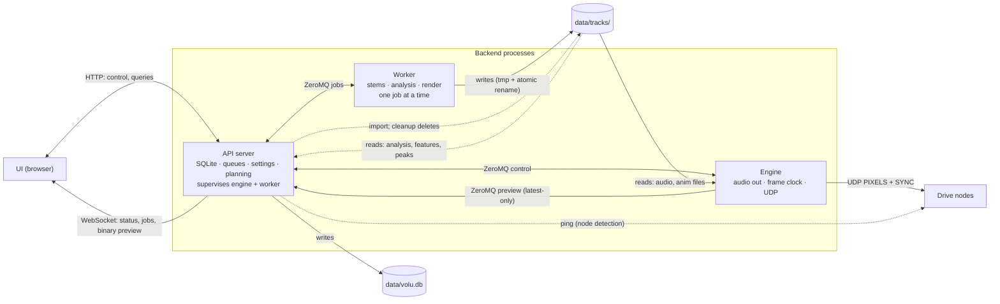
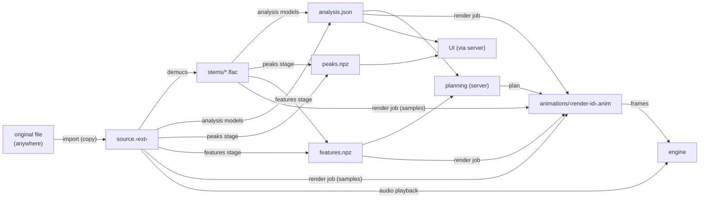

# Architecture (gen_system)

Status: **working draft.** This file describes the current design of the host
software. The design will change as it is refined and during development.
Update this file in place when the design changes. Record settled,
non-obvious choices in `decisions/`. Where this file and the "Recommended
approach" section of `gen_system/AGENTS.md` differ, this file overrides that
section.

Open questions are at the end.

Related: `ui.md`, `generators.md`, `protocol.md`,
`decisions/0004-audio-analysis.md`, `decisions/0006-waveform-peaks.md`,
`decisions/0007-ipc-zeromq.md`, `decisions/0008-animation-file-format.md`,
`decisions/0009-audio-output-api.md`, `decisions/0010-display-fps.md`,
`decisions/0011-planning-in-server.md`, `decisions/0012-stem-features.md`,
`decisions/0016-drum-onsets-adtof.md`, `decisions/0020-brightness-no-power-cap.md`.

---

## Principles
- **Offline generation, dumb playback.** The system generates animations
  ahead of time: audio → stems → analysis → animation file. This work can be
  slow. Playback only reads files. It does no analysis and no rendering in
  the hot path.
- **The audio clock is the master clock.** The engine derives the frame
  index from the playback position of the audio device. It never uses
  wall-clock timers.
- **The UI is a remote control.** It sends commands and draws what the
  backend reports. A UI freeze, reload, or crash never affects audio or
  frames.
- **One writer per store.** Exactly one process writes each file or
  database. (The server also deletes files under `tracks/` for cleanup. It
  never writes them after import.)
- **Real-time threads never block on anything.** They do no IPC, no file
  I/O, and they do not wait for other processes.

## Processes



| Process | Role | Writes | Never does |
|---|---|---|---|
| API server | Coordinator. The only holder of persistent state. Plans renders | SQLite. New track dirs on import. On request, it deletes unreferenced animation files, leftover `*.tmp` files, and orphaned track dirs | Timing, model inference, rendering frames |
| Engine | Plays audio, sends frames | nothing | DB access, HTTP, models |
| Worker | Runs GPU and batch jobs | `data/tracks/` (everything after import) | DB access, playback |

The UI talks only to the API server.

### API server
- FastAPI + uvicorn, one asyncio loop. Entry point:
  `volu serve --display <config>`. It starts the engine and the worker. It
  restarts them if they die.
- **Startup looks for running children first.** Before it starts a child,
  the server sends `hello` to the port of that child, with a short timeout.
  The `hello` reply carries the PID of the child.
  - **Engine answers:** the server adopts it. The engine may be playing out
    after a server crash. The server has no process handle for an adopted
    engine, so only heartbeats show a crash. The server restarts the engine
    if the heartbeats stop.
  - **Worker answers:** the server kills it by PID, starts a new one, and
    queues again the job that the old worker was running. Kill is the only
    recovery path for jobs.
  - The startup `*.tmp` cleanup runs only after the old worker is gone. This
    way it never deletes a file that is still being written.
  - Jobs that the DB shows as running go back to the queue first.
  - The startup order is: queue again the running jobs → kill a surviving
    worker → delete leftover `*.tmp` files → start the worker → adopt an
    engine that answers `hello` within 1 s, else start one → node pings →
    animation file cleanup → first job dispatch (`server/core.py`).
- **A clean stop** (Ctrl+C) sends `shutdown` to the engine, then kills the
  engine and the worker if they did not exit. Only a crash of the server
  leaves the engine playing.
- **Connect-only mode** (`volu serve --connect-only`): the server starts no
  children and restarts none. It connects to an engine and a worker that
  the user started by hand on the same ports. It adopts the job that a
  running worker reports. It deletes no `*.tmp` files, because it cannot
  kill the worker. It can cancel only render jobs (`cancel`).
- **Event loop:** the server needs a selector event loop, because
  `zmq.asyncio` needs `add_reader`. On Windows, the default loop of uvicorn
  is the Proactor loop. Therefore `volu serve` runs uvicorn with
  `loop="asyncio:SelectorEventLoop"`. The server refuses to start on a
  Proactor loop (decision 0007 → Amendment 2).
- **SQLite** holds these items:
  - tracks (key, name, original path, duration, analysis status, BPM, tempo
    mode)
  - versions (draft or saved, track params, plan, generator version, fps,
    format version, geometry hash, file path)
  - presets
  - settings
  - the play queue
  - the job queue

  The server is the only writer.
- **Imports tracks** (see Storage layout → Import). It copies uploaded or
  scanned audio into a new track directory. Then it gives the track to the
  worker.
- Loads and validates the active display config. It confirms these points:
  no overlaps, full coverage, ≤ 64 strips per node, and the longest strip
  fits the display FPS. It also computes the **geometry hash**. The config
  is the one given at start. To switch configs, restart the server. The UI
  shows the config as read-only. The server sends the config path and the hash to
  the engine and the worker, so all three agree on the geometry.
- **Plans renders** (`generators.md` → Plan,
  `decisions/0011-planning-in-server.md`). The server runs the director of
  the generator in its own process. The director turns `analysis.json`,
  `features.npz`, the track params, and the pinned instance edits of the
  user into a plan. Planning is pure Python with no models (milliseconds),
  so it runs on demand:
  - on every track-param or instance edit
  - after a grid override
  - before a render whose version has no plan yet (the default render on
    import)
  - before a render whose plan came from another generator version or
    method version. The new plan overwrites the stored plan.

  In all other cases, a render uses the stored plan unchanged. An example is
  an FPS re-render (Main flows 6). One step happens before every render: the
  server recomputes the `start` and `end` of each segment from its bars on
  the current grid. Planning runs off the event loop
  (`asyncio.to_thread`) and is deterministic. The worker only renders the
  plan it receives.
- **Node detection:** the server pings the configured IP of each node and
  pushes the set of online nodes to the engine. This function moves into the
  engine when protocol type 3 (status) exists.
- **UI API:** HTTP for these items:
  - library, analysis, peaks, settings, versions, presets
  - schemas of generator parameters and method parameters
  - plans. The UI gets the plan. The UI sends the full state (track params
    plus every instance override) and gets the new plan in the response. The
    UI sends the full state, not a delta, so the undo of the UI can send an
    earlier state again.
  - jobs. Failed jobs keep their error and traceback for the UI. Retry
    queues the same spec again.

  One WebSocket carries live state: engine status, job progress, node
  status, and binary preview frames. Preview frames are latest-only. A slow
  browser drops frames. The server never queues them.
- **Engine state is a function of server state.** On every engine
  (re)connect, the server sends a full `configure`. The engine keeps no
  persistent state of its own.
- Owns the **play queue** and the **job queue** and their policies:
  priority, preloading of the next track, and cleanup of unreferenced
  animation files.
- Owns the **engine mode** (`ui.md` → Engine modes). **Playback** plays the
  queue. **Studio** plays the track that is open in Studio (Main flows 7).
  The engine does not know the mode. It only gets the matching `load`
  messages.

### Engine
The engine is the real-time process. It is as small as possible. It receives
file paths and commands, plays audio, and sends frames. It runs at raised
process priority, with 1 ms timer resolution on Windows.

**Threads**

| Thread | Does | Never does |
|---|---|---|
| Audio callback (PortAudio via `sounddevice`) | Copies samples from the preloaded buffer. Records `(dac_time, sample_index)` for each buffer. `sample_index` is one output counter that continues across tracks. Switches current → next at the exact sample (gapless). Records the counter value where `next` starts | I/O, allocation, long locks |
| Frame | For each frame: reads the clock, picks the frame index, takes the frame from a decoded chunk, packetizes it, sends PIXELS to every online node (when armed), and sends one SYNC broadcast. Writes the preview frame (picked with `preview_offset`) to the preview slot | IPC, file loading |
| Loader | Decodes audio and opens animation files into the `current` and `next` slots. For `swap_anim`, it decodes the playhead chunk of the new file before the swap (decision 0008) | Anything timed |
| Prefetch | Keeps the playhead chunk of the animation and the next chunk decoded (decision 0008). After a seek, it decodes the chunk of the new playhead first | Anything timed |
| Control | Does IPC with the server. Publishes status (~20 Hz) and preview (preview FPS setting, ≤ display FPS) from shared slots | Block the real-time threads |

The real-time threads share state with the control thread only through small
lock-guarded slots or atomic reference swaps.

**Clock.** The frame thread reads `stream.time`. This is the same time base
as the DAC timestamps of PortAudio:

```
heard_pos(now) = sample_index + (now − dac_time) × sr      # sample at the speaker now
frame          = floor((heard_pos / sr + display_offset) × fps)
```

`sr` is the sample rate of the output stream. `sample_index` counts the
samples sent to the device, after any resampling to the device rate
(decision 0009). It does not count the samples of the source file.

**Track boundaries.** The counter never resets, so one target time
(`heard_pos / sr + offset`) covers a gapless track change. Each slot records
the counter value where its audio starts. The frame thread takes the frame
from the slot whose range holds the target time. It uses the time from the
start of that slot. With a positive offset, the lights reach the first
frames of the next track before its audio does. With a negative offset, the
last frames of the previous track still show after its audio ends. The
preview does the same with `preview_offset`. Before the first track starts,
or after the end of the last track, the frame is black.

The frame thread wakes at the **display FPS**. This is a UI setting: any
whole number from 30 to 480 (see Settled → Display FPS). A loaded animation
always has that rate. The engine refuses to `load` or `swap_anim` a file
with a different fps. When a `configure` sets a new display FPS, the engine
stops and unloads any animation at the old rate.

- `display_offset` is the **A/V sync offset**, a user setting in ms
  (positive = lights earlier). It covers audio output latency, network and
  latch time, and all other causes of misalignment between sound and light.
  The calibration flash + click sets it. The user can also adjust it by hand
  from the UI at any time (`ui.md` → Sync).
  - **Applied live:** a change goes out in `configure` and takes effect at
    the next frame. There is no reload and no playback interruption. The
    jump is at most the size of the change. Nudges are small.
  - **Stored for each audio device + output mode** (for example WASAPI
    shared or exclusive), because their latency differs. When the user
    switches the device, the offset switches too.
  - The resolution is finer than a frame (33 ms at 30 FPS, 8.3 ms at 120,
    2.1 ms at 480). The offset changes which frame the engine picks, so
    small nudges take effect at frame boundaries.
- `preview_offset` is the same idea for the UI preview. The preview has its
  own path (ZeroMQ → WebSocket → browser → monitor). The frame thread picks
  the preview frame separately, at `heard_pos / sr + preview_offset`. This
  way the hardware offset never makes the preview run early or late.
- The engine never drops, holds, or resamples frames to fit another rate. A
  file at another fps is not playable until it is rendered again (Main flows
  6). There is one case of holding: a late frame. Just after a seek, the
  chunk of the playhead may not be decoded yet. Then the frame thread
  repeats the last frame and counts it in `status` (decision 0008).
- At high rates, the 1 ms timer resolution is a large part of the frame
  (2.08 ms at 480 FPS). Measure the wake jitter there. If needed, use a
  high-resolution waitable timer, or spin for the last part of the wait.
- The frame counter of the protocol sender is separate from the frame index.
  It keeps incrementing across seeks, track changes, and test patterns.
- Smooth the clock (for example with a filter over the anchors) only if
  measured jitter shows a need.

**Frame sources.** `AnimationSource`, `TestPatternSource`, and
`CalibrationSource` (flash + click mixed into the audio). Each source maps a
frame index → `colors[P, 3]` in geometry order. Test patterns and
calibration use the same output path as playback.

**Output.** Mapping + packetizer → UDP sender (`protocol.md`, v2). When
output is disarmed, the engine still produces and previews frames, but it
does not send them. Armed output goes only to nodes in the online set. The
engine applies global brightness here, to the sent frames and the preview
frames alike. The user can adjust brightness live, like the sync offset
(`generators.md` → Output and render job). There is no power cap
(`decisions/0020-brightness-no-power-cap.md`).

**Slots.** `current` and `next` each hold decoded audio and an open
animation file. The engine preloads `next`, so a track change is gapless.
After a change, the old `current` becomes `previous` and keeps its animation
open. When both target times (display and preview) are past its end, the
engine closes the animation and sends `released`. `swap_anim` replaces the
animation in `current`. It does this at the first frame after the loader
decodes the playhead chunk of the new file. Audio and playhead stay the
same.

**Command line.** The server starts the engine with this command:

```
python -m volu_gen.engine --display <config> --data <data dir> --host <ip>
    --control-port <port> --preview-port <port>
```

The engine binds its `ROUTER` on the control port and its `PUB` on the
preview port, at the given host (IPC). Until the `volu_gen.engine` module
exists, the server does not start an engine. It logs this once and runs
without one. Transport commands then fail with 409.

### Worker
- One process, one job at a time, below-normal priority. It follows the GPU
  rules in `decisions/0004-audio-analysis.md`: one model loaded at a time,
  < 8 GB VRAM.
- **Jobs are pure:** a spec goes in, and files plus a result message come
  out. No DB.
- The worker writes all outputs to `<name>.tmp` (`.anim.tmp`,
  `peaks.npz.tmp`, …) and renames them atomically, so
  **killing the worker is always safe**. To cancel a model stage, kill and
  restart the worker. Render jobs may also cancel cooperatively between
  chunks.

| Job | Spec | Result |
|---|---|---|
| `analyze` | key, stages (default all), force set | key, duration, BPM/grid summary, time and peak VRAM of each stage that ran. The first stage that fails fails the job |
| `regrid` | key, BPM + downbeat time (both empty: clear the override) | key, duration, BPM/grid summary. The new phrases, events and bars are in `analysis.json` (CPU, seconds) |
| `render` | key, render id, output path, generator id, plan (made by the server, `generators.md`; it carries the track params), fps (the display FPS when the job starts), geometry hash | the version row's columns: render id, anim path, frame count, fps, pixel count, geometry hash, format version, generator id + version, the tempo override the render used |

The worker refuses a render for another geometry hash than that of its own
display config, an output path other than
`tracks/<key>/animations/<render id>.anim`, and a stale plan
(decision 0018).

Run it alone with `python -m volu_gen.worker --display <config>`
(`worker/__main__.py`). The main thread owns the socket. The job runs in a
second thread, which only queues messages for the main thread to send.

**Tracks are processed in series.** A multi-file upload or a folder scan
queues one `analyze` job for each track. Each track gets its default
`render` before the `analyze` of the next track starts. This way the first
tracks become playable while the rest wait. There is no second worker and no
parallel processing. The cost is that each track loads and unloads every
model itself, instead of sharing one load across a batch. This takes seconds
for each stage, which is small compared to demucs.

**Priority** (highest first):
1. Studio render and `regrid`.
2. Render for a queued track.
3. Import work: `analyze` plus its default render (FIFO). Also "Re-render
   stale" and manual FPS re-renders.

When the `analyze` of a track finishes, its default render goes to the front
of the import work. It runs before the `analyze` of the next track. Within a
priority, the other jobs run in the order they were queued
(`server/jobs.py` → `next_job`). The user
can queue a track whose import is not finished. Then the remaining import
work of that track (`analyze` and its default render) moves up to "render
for a queued track". The worker never preempts a job in the middle of a run. A job
with higher priority starts when the current job finishes. This takes at
most one track analysis or one render (minutes per track on the large
display, decision 0010).

## IPC
ZeroMQ (`pyzmq`) over `tcp://127.0.0.1`. The full rationale is in
`decisions/0007-ipc-zeromq.md`.

| Link | Sockets |
|---|---|
| Server ↔ engine control | engine binds `ROUTER`, server connects `DEALER` |
| Engine → server preview | engine binds `PUB`, server connects `SUB` (`CONFLATE`: latest-only. The engine never blocks. The `PUB` keeps the default HWM: decision 0007 → Amendment) |
| Server ↔ worker jobs | worker binds `ROUTER`, server connects `DEALER` |

- **The child binds and the server connects.** This way a restarted server
  can reconnect to a running engine. ZeroMQ reconnects automatically.
- **Messages:** pydantic models in one shared module
  (`volu_gen/ipc/messages.py`), encoded with MessagePack (no pickle). Each
  message has a `type` field. A preview frame is a 16-byte little-endian
  header (frame index `int64`, track id `int64`, −1 for none) and then the
  raw RGB bytes in geometry order. It uses its own socket, so bulk data
  never delays control messages. Paths in messages are relative to the data
  dir. The message models reject absolute paths and `..`. The server gives
  each child the data dir when it starts it.
- **Sockets:** `volu_gen/ipc/sockets.py` makes all of them. The server's
  `DEALER`s keep the routing id `server` across reconnects. The children's
  `ROUTER`s use `ROUTER_MANDATORY` (a send to an absent server fails, and
  the message is not queued) and `ROUTER_HANDOVER`.
- **Connection lifecycle.** ZeroMQ hides connections. Without extra steps,
  it would queue messages for an absent peer. These steps prevent that:
  - `ZMQ_IMMEDIATE` on the sockets of the server: nothing is queued while a
    child is down. A failed send means "peer down".
  - A `hello` handshake on every (re)connect. Then the server sends the full
    `configure` (engine) or submits the job again (worker).
  - Liveness: process handles show crashes. ZeroMQ heartbeats show hangs.
- Ports are fixed, configurable defaults: engine control 8771, engine
  preview 8772, worker 8773 (the HTTP port is 8770). The server passes
  them to the children at start.
- The control thread of the engine owns its sockets (they are not
  thread-safe). libzmq does the I/O in its own C thread, outside the GIL.

**Server → engine**

| Message | Fields / meaning |
|---|---|
| `hello` | Sent on connect. The engine replies `hello` |
| `configure` | Display config path, geometry hash, audio device + output mode (shared/exclusive), display FPS, preview FPS, display offset (ms), preview offset (ms), network interface, armed, online nodes, brightness. Full snapshot. Sent on connect and on any change |
| `load` | slot (`current`/`next`), track id, audio path, anim path, start time |
| `swap_anim` | anim path. Replaces the current animation at the playhead |
| `play` / `pause` / `stop` / `seek{t}` | transport |
| `clear_next` | Drops the preloaded next track |
| `test{pattern, params}` / `test_off` | test patterns, calibration |
| `shutdown` | Sent on a clean server stop. The engine stops and exits |

**What the server expects from the engine.** The player
(`server/player.py`) relies on these rules:
- `load(current)` replaces the current slot and keeps the transport state
  (playing or paused). On a stopped engine, it leaves the engine paused at
  `start`.
- `stop` empties both slots.
- The engine sends `released` for every animation file that it closes:
  after a track change, a `swap_anim`, a `load` that replaces a slot,
  `clear_next`, and `stop`. Until then, the server keeps the file
  (Lifecycle → Cleanup).
- `status` arrives at ~20 Hz. If no message arrives for 3 s on a
  connected engine, the server kills the engine and starts it again
  (`server/engine_link.py`). ZeroMQ heartbeats do not show a hung engine,
  because libzmq answers them from its own thread.

**Engine → server**

| Message | Fields / meaning |
|---|---|
| `hello` | Reply to the `hello` of the server: engine instance id, PID, current state (loaded slots, position) |
| `status` (~20 Hz, also the heartbeat) | state, track id, position (s), frame, actual fps, late frames, audio xruns |
| `preview` | Binary RGB frame, geometry order (at the preview FPS setting, latest-only) |
| `track_started` / `track_ended` | track id |
| `released` | The anim path is no longer open (safe to delete) |
| `error` | kind, message |

**Server → worker:** `hello`, `submit{job_id, spec}` (the spec has a
`kind`: `analyze`, `regrid` or `render`), and `cancel{job_id}`. A `cancel`
works for render jobs only, and the worker honors it between chunks. To
cancel any other job, kill and restart the worker. The new worker
reconnects and says `hello`.

**Worker → server:** `hello{pid, job_id}`,
`progress{job_id, stage, track, frac, eta}`, `done{job_id, result}`,
`failed{job_id, error, traceback}`, `cancelled{job_id}` (a render stopped
by `cancel`; it wrote no file), and `log{line}`.
- The worker runs one job at a time. It refuses a `submit` while a job
  runs (`failed`: busy). It ignores a second `submit` of the running job.
- `progress` is latest-only: the worker sends at most one every 50 ms.
- A result (`done`, `failed`, `cancelled`) that the worker cannot send
  because the server is gone is kept. The worker sends it before its reply
  to the next `hello`. Until the server has the result, the job counts as
  running, and `hello` reports its id. So a reconnected server always sees
  the job as either running or finished.
- The worker exits when no server has been connected for the heartbeat
  timeout (3 s).

## Main flows
1. **Add track.** The UI sends `POST /tracks` (file upload) or
   `POST /tracks/scan` (folder path). Then these steps occur:
   1. The server imports each file into `tracks/<key>/`. If the file is
      already in the library, the server returns its track. The directory of
      the file can exist without a DB row (for example, it stayed after a
      removal). Then the server gives it a new row. It goes through the same
      steps, which skip finished stages.
   2. The server inserts the row and queues `analyze`.
   3. The worker sends `progress`. The UI shows it in the jobs drawer.
   4. The worker sends `done`. The server updates the track, plans it with
      the default track params, and queues `render` with that plan. This
      creates the draft row of the track.
   5. The worker sends `done`. The server marks the draft as rendered and
      sets it active.
   6. The `analyze` of the next imported track starts (see Worker: tracks
      are processed in series).
2. **Play the queue.** The server resolves the active version of each track.
   It sends `load(current)`, `load(next)`, and `play`. At the end of the
   track, the engine switches to `next` at the sample and emits
   `track_ended` and `track_started`. The server pops the queue and sends the
   new `load(next)`. **The server skips unrendered tracks.** It never waits
   for them. `next` is the first queued track whose active version is
   playable (Lifecycle: rendered at the display FPS, matching pixel count,
   readable format version). The user can add a track to the queue whose
   active version has another fps. Then the server queues its FPS re-render
   at "render for a queued track" priority (decision 0010). Skipped tracks keep
   their place at the front of the queue and keep rendering. If a skipped
   track becomes ready before the current track ends, the server replaces
   `next` with it (`clear_next` + `load(next)`).
3. **Studio edit + re-render.** These steps occur:
   1. The user edits a track param or an instance. The server re-plans at
      once and keeps the pinned segments. It returns the plan. The UI
      redraws the segment lane and marks the draft as out of date.
   2. The user presses **Render**. The server sends `render` (top priority)
      with that plan. The worker writes
      `tracks/<key>/animations/<render-id>.anim`.
   3. The server sends `swap_anim`. The engine switches at the next frame
      and reports `released{old}`.
   4. The server deletes the old draft file, unless a saved version now uses
      it (Lifecycle).

   **Every render gets a new filename.** Windows cannot replace or delete a
   file that is open or memory-mapped.
4. **Grid override.** The server queues a `regrid` job. Then it re-plans the
   draft. Segments are anchored by bar, so pinned segments keep their place.
   The server tells the UI that the analysis and the plan changed, and the
   UI gets them again. The user renders again when ready. Saved versions
   keep their plans. Every version rendered on the old grid is now stale
   (Lifecycle). When the user renders such a version again, its segments
   move onto the new grid without a new plan.
5. **Seek / pause / test patterns / calibration.** UI → server → one engine
   command for each action. The UI shows only what `status` reports.
6. **Display FPS change** (Settings, `decisions/0010-display-fps.md`).
   1. The UI asks for confirmation first. It shows how many versions become
      unplayable.
   2. The server sends `stop`, stores the rate, and sends `configure`.
   3. The engine wakes at the new rate. Test patterns and calibration keep
      working. No animation is loaded.

   Every version with a different fps is now unplayable. The server cancels
   a running render and queues it again. It also queues an **FPS re-render**
   of the active version of every track in the play queue, at "render for a
   queued track" priority. The user re-renders other tracks by hand with one
   of these controls:
   - a Library row action
   - the Library bulk action "Re-render FPS mismatch"
   - a button on the active version in the version bar of Studio

   These renders run like import work. An FPS re-render covers only the
   active version. It uses the stored track params and the stored plan of the
   version unchanged. (As for every render, the server recomputes segment
   times from bars on the current grid. The server re-plans first only if
   the generator or a method version changed. See API server above.) It
   **replaces the file of the version in place**: same version row, new
   render id. The server deletes the old file as described in Lifecycle
   below.
7. **Enter / leave Studio** (`ui.md` → Engine modes).
   - Entering: the server pauses, sends `clear_next`, and sends
     `load(current)` for the selected version of the Studio track, paused at
     the start. Studio keeps no playhead for each track. When the user opens
     a track, or switches to another, it starts at 0.
   - Leaving: the server loads the current track of the queue again, at the
     position where the user left it, **paused**. It also loads its `next`.
     The user presses play.

## Failure handling

| Crash | Effect |
|---|---|
| UI | None. |
| Server | Playback continues. The engine plays out current + next, then idles. The worker exits when the server has been gone for longer than the heartbeat timeout. A restarted server adopts the running engine (API server → Startup) and sends `configure` again. It reconciles the queue from the `hello` state of the engine, kills any surviving worker, and queues again the jobs that were running |
| Worker (for example OOM) | The server marks the job as failed and restarts the worker. The queue continues. Atomic renames mean there are no partial files |
| Engine | The server restarts it and sends `configure` again. It loads the current track **paused** at the last reported position, and the preloaded `next` |

## Data layers
These layers are distinct and separately testable (from
`gen_system/AGENTS.md`):
1. **Geometry** — display config → a 3D position for every pixel (with
   odd-slice offsets). Generators, the UI preview, and the mapping use it.
2. **Voxel frames** — one RGB color for each pixel, in geometry order (strip
   by strip, top to bottom: `i = (z * X + x) * Y + y`, decision 0013).
   Generators evaluate fields at pixel positions. They never assume a grid.
   They never know about nodes, strips, or packets.
3. **Mapping** — pixel → (drive node, strip, pixel index) from the `section`
   of each node. The system validates it on load.
4. **Output** — the packetizer (mapping + frame → UDP packets) and the
   sender.

## Storage layout
`data/` is gitignored (`data/README.md`).

| Path under `data/` | Contents | Writer |
|---|---|---|
| `volu.db` | SQLite: tracks, versions, presets, settings, queues | server |
| `tracks/<key>/` | Per-track data: source audio, stems, analysis, peaks, features, animations (below) | The server creates it on import. After that, the worker writes it (the server only deletes) |

**`<key>`** is the first 16 hex digits of the SHA-256 of the bytes of the
imported file. If the user imports the same file again (under any name or
path), the system finds the existing track. A re-encoded or edited file is a
new track. The DB maps track id ↔ key.

**Import copies the audio in.** No library folder exists that the system
reads audio from. The audio of every track lives in its own directory as
`source.<ext>`. The reasons are:
- Browser uploads have no path to refer to. They have only bytes.
- Tag edits to the original, or a move of the original, change nothing. The
  key is the hash of the copy made at import.
- Tracks keep playing and rendering when the drive of the original is
  missing.
- A track directory is self-contained, so the engine and the worker read
  only `data/`. To back up the library, copy one folder.

The cost is one extra copy of each source file (FLAC ≈ 17–72 MB per track in
the current library). This is small compared to the stems and animations.

**This is stored data, not a cache.** It holds these items:
- user input that the system cannot regenerate (the grid override)
- results that took minutes of GPU for each track, and that newer models may
  not reproduce exactly
- the renders that the user approved

The server deletes only what the system itself replaced or left behind.
This is a list of those items (Lifecycle):
- superseded draft files
- the old file of a version after an FPS re-render
- animation files that no DB row references
- leftover `*.tmp` files

The server deletes everything else under `tracks/` only on request (removing
a track, orphaned track directories).

This diagram shows how the files in a track directory derive from each
other:



### `data/tracks/<key>/` — per-track data
`TrackDir` and `import_track` (`analysis/track.py`) implement this.

**Import** (`import_track`):
- It reads the original once. It hashes the data while it copies it into
  `tracks/.import-<uuid>.tmp`. Then it renames the copy to
  `tracks/<key>/source.<ext>` (extension in lowercase). The copy and the
  target are on the same volume, so the rename is atomic.
- If `<key>` already has a source, it discards the copy. It returns the
  existing track and does not write to it.
- A new track gets an `analysis.json` with only the `source` block:
  `sha256`, `name` (the original filename without extension), and
  `original_path` (where the file came from). `original_path` is
  informational. The system never reads it back.
- The sources of an import are:
  - a browser upload (**Add files**)
  - a folder path that the user types in the UI (**Scan folder**, which
    imports every audio file under it)
  - the CLI (`python -m volu_gen.analysis <files or folders>`). The CLI is
    for development only. It bypasses the server, so its tracks get no DB
    row. They show up in Settings as orphaned track directories.

**Removing a track** from the library: the UI asks whether to also delete
its directory. If the user keeps the directory, adding the same file again is
instant (no demucs). Settings lists orphaned track directories (no DB row)
with their size. The user can delete them there.

**Audio-derived files** do not depend on the display or on the generators:

| File | Contents | Produced by | Size (current library) |
|---|---|---|---|
| `source.<ext>` | The imported audio, byte-for-byte. Any format that ffmpeg decodes | import | ~17–72 MB (FLAC) |
| `stems/vocals.flac`, `drums.flac`, `bass.flac`, `other.flac` | demucs `htdemucs` stems, stereo, 44.1 kHz (`BASE_SR`), FLAC | `stems` stage | ~45–180 MB per track in total. This is most of the directory |
| `analysis.json` | Tempo/grid (including the user `override`), sections, phrases, events, energy for each bar, genre, mood, model ids. Schema: decision 0004 | model stages + `phrases`. `regrid` jobs | ~30 KB |
| `peaks.npz` | min/max/rms pyramid for the mix and four stems, int16. Format: decision 0006 | `peaks` stage | ~16 KB per second of audio |
| `features.npz` | Stem features for generators: envelopes for each lane (300 Hz), 24-band spectra and stereo width (100 Hz), and onset lists for kick and hat from the drums stem via ADTOF (decisions 0016, 0017). The rates are fixed. They do not depend on the display FPS or on the grid. Format: decision 0012 | `features` stage (CPU, after `peaks`) | ~8 MB for a 6.6-min track |
| `check/` | Listening aids: `clicks.wav`, `onsets_<class>.wav`, Audacity `labels_*.txt` | `analysis/checks.py`, on request | For development only. The system never reads it. Safe to delete |

- The system does not store the decoded mix. It decodes `source.<ext>`
  whenever it needs the audio (analysis, peaks, features, render jobs,
  engine playback).
- **`analysis.json` is the source of truth** for analysis. This includes the
  BPM / grid-offset override (`tempo.override`, written by `regrid` jobs).
  The DB keeps only a copy of what the Library table shows (BPM, tempo mode,
  status). Job results update this copy.
- **Invalidation** (`analysis/pipeline.py` and `track.py` implement it):
  - A model stage runs again when its output is missing, when its model id
    in `models` changed, or when the user forces it.
  - `phrases`, `events`, and `bars` are derived again when an earlier stage
    ran again, or when the override changed.
  - An `analysis.json` of an older compatible `version` keeps the model
    outputs and drops only the derived keys. The system rebuilds any other
    version.
  - `peaks.npz` and `features.npz` are computed again when their `version`
    differs, or when any stem file is newer than they are (decisions 0006,
    0012). Neither runs again on a grid override or an FPS change.

**`animations/` — rendered animations.**
Each render has one file: `animations/<render-id>.anim`. Unlike the files
above, these files depend on the display geometry and on the generator. The
**server picks the render id** (a ULID or UUID) and the output path when it
queues the job. This way the DB row exists before the file does. The worker
writes `<render-id>.anim.tmp` in the same directory. It renames the file when
the job finishes.

**What a file holds.** Format: `decisions/0008-animation-file-format.md`.
It is a single file with these parts, in order:
1. a header and JSON metadata
2. the frames, in independently zstd-compressed chunks of 1 s
   (`chunk_frames` = the fps of the file, 30–480 frames). Each chunk may have
   a temporal-delta filter.
3. a chunk index and a footer

The format is lossless. Any frame decodes from the start of its chunk. The
file holds:

| Part | Contents |
|---|---|
| Metadata | format version · render id · track SHA-256 · geometry hash · pixel count `P` · fps · frame count · generator id + version · track params (JSON) · plan (JSON) · `analysis.json` version and the tempo override in effect · created time |
| Frames | `frame_count × P × 3` uint8 RGB in geometry order. Frame `i` shows at `i / fps` s from the start of the audio |

The file does not hold:
- **Audio.** The engine plays the `source.<ext>` of the track from the same
  directory.
- **The node/strip mapping.** The system applies it at playback. When the
  user rewires drive nodes (with unchanged pixel positions), no new render
  is necessary. Therefore the geometry hash covers only pixel positions and
  order. It does not cover `drive_nodes`.

**Size** (uncompressed, `P × 3 × fps` bytes/s). The table shows the default
120 FPS. The size is linear in the rate: 480 is 4×, and 30 is ¼. Compression
is 4–50× depending on content, from synthetic benchmarks in decision 0008.
Measure it again on real renders.

| Display | Pixels | Per second | 4-min track | 4-min track, compressed (est.) |
|---|---|---|---|---|
| Prototype | 960 | 346 KB | ~83 MB | ~5–20 MB |
| Large build (example) | 20,000 | 7.2 MB | ~1.7 GB | ~35–420 MB |

**Lifecycle.** All state is in the DB. The files only follow it.
- **Draft:** each track has one draft row. Its first render creates it. Each
  Studio render or default render gives that row a new file and a new render
  id. The server deletes the previous draft file after the engine has
  `released` it (immediately, if the engine has not loaded it). The server
  keeps the file if a saved version uses it.
- **FPS re-render** (Main flows 6): it replaces the file of the active
  version in place. The version can be the draft or a saved version. The row
  keeps its params and plan. It gets the new file, fps, and render id. The
  server deletes the old file after the engine `released` it.
- **Save draft as version:** this creates a saved row with the params, the
  plan, and the file of the draft (no file copy). The two rows share the
  file until the next render gives the draft a new file.
- **Active:** a pointer to one version, draft or saved. The queue plays this
  version. After import, it is the draft, so Studio renders change what the
  queue plays. To freeze a version, save it and set it active.
- **Loaded file replaced:** a render can replace the file of a version that
  the engine has loaded. Examples are a Studio render and a re-render of the
  active version. Then the server sends `swap_anim`.
- **Stale:** a file is stale when one of these items differs from the
  current one:
  - its geometry hash
  - its generator version
  - any method version in its plan
  - its format version
  - the tempo override in effect

  A stale file still plays if all of these are true:
  - the pixel count matches
  - its fps is the display FPS
  - the reader still supports its format version (decision 0008 rejects
    unsupported versions)

  The UI flags it. A render of a version that is stale by generator version
  or method version re-plans it first (API server above). A version that is
  stale only by the grid keeps its plan.
- **FPS mismatch:** the fps of the file differs from the display FPS. The
  file is **not playable**. The queue skips it, Studio cannot play it, and
  the engine refuses it. An FPS re-render (Main flows 6) clears the mismatch.
  Switching back to the rate of the file also clears it.
- **Cleanup:** the server deletes animation files that no DB row
  references (`server/cleanup.py`). It keeps these files:
  - the output file of a queued or running render job
  - every file that the engine may have open: the server sent it in `load`
    or `swap_anim`, and the engine has not yet sent `released` for it

  The server runs this cleanup at startup, after each job result, after a
  `released`, and after a track removal. On startup, after any surviving
  worker is gone, it also deletes leftover `*.tmp` files. In connect-only
  mode it does not delete `*.tmp` files.

## Backend package layout
| `volu_gen/` module | Purpose |
|---|---|
| `analysis/` | implemented (decision 0004) |
| `geometry/` | display config → positions, geometry hash. Implemented (decision 0013) |
| `mapping/` | pixel → node/strip/index, validation. Implemented (decision 0013) |
| `animfile/` | animation file read/write. Implemented (decision 0008) |
| `generators/` | director, plan, methods (`generators.md`). Implemented: `Music`, `RenderContext`, the method interface, the plan model, the director, the render job, and the first methods (`geometry`, `raindrops`, `strobe`, `galaxy`, decision 0019). The other methods are still to come. The server imports it (planning: the director and the `choose_params` of each method). The worker imports it (rendering). Therefore it has no torch or other heavy imports at module level |
| `output/` | protocol v2, packetizer, UDP sender, simulated node, test-pattern CLI. Implemented (brightness is still to come) |
| `engine/` | engine process (threads, clock, sources, slots) |
| `worker/` | worker process (job runner). Implemented: the jobs (`analyze`, `regrid`, `render`) and the process (`python -m volu_gen.worker`) |
| `server/` | API server (FastAPI, DB, queues, supervision). Implemented: the DB, settings, the library (import, removal, storage), analysis and peaks for the UI, planning, versions, presets, the play queue, the job queue with its order, job dispatch to the worker (`dispatch.py`), the engine link (`engine_link.py`), the player (`player.py`: engine modes, queue → engine slots, Studio), supervision of the children (`children.py`, `core.py`), file cleanup (`cleanup.py`), node detection (`nodes.py`) and the WebSocket (`live.py`). See API server, IPC and HTTP API above and below. The server starts the engine, but the engine itself is still to come |
| `ipc/` | message models, connection helpers. Implemented (decision 0007) |

## HTTP API
The server serves the UI API under `/api` (`server/app.py`). FastAPI
publishes the full schema at `/docs` while the server runs. The default
address is `127.0.0.1:8770`. These rules apply:
- **JSON** for everything except two binary endpoints. The UI reads them
  into a typed array with no parsing:
  - `GET /display/positions`: `(P, 3)` float32 little-endian, mm, in
    geometry order, config axes (y down).
  - `GET /tracks/{id}/peaks/{level}`: int16 little-endian,
    `(lanes, 3, buckets)` with the middle axis `[min, max, rms]`
    (decision 0006). `GET /tracks/{id}/peaks` gives the lanes and the
    bucket count and rate of each level.
- **Errors:** 404 for an unknown id, 409 when the state does not allow the
  action (for example, planning before the analysis is finished), and 422
  for a value that a model rejects. A 422 names the field, so the UI shows it
  inline.
- **Planning:** `POST /tracks/{id}/plan` takes the full Studio state
  (`params` and `pinned`: the start bar, end bar, method and overrides of
  each edited instance). It stores the params and the plan in the draft row
  and returns the plan. `GET /tracks/{id}/plan` returns the same state, so
  the UI can restore its form.
- **Settings** change with `PATCH /settings` (only the given fields).
  `PATCH /sync` changes the offsets of the current audio device + mode.
  `GET /settings/fps-impact?fps=N` gives the counts for the confirmation
  of a display FPS change. It also gives an estimate of the time for the
  automatic re-renders, from the times of recent renders (null before the
  first render).
- **A job row names its work; the server builds the spec when the job
  starts.** A render job row holds the version id, the render id, and the
  output path (picked at queue time). The plan, the fps, and the geometry
  hash come from the version row and the settings when the job starts. This
  way a render uses the latest plan and the display FPS in effect at its
  start (decision 0010). A second render request for a version that has a
  queued render returns that job.
- **Jobs:** `DELETE /jobs/{id}` cancels a queued job, or the running job.
  A running render stops between chunks (`cancel`). The server stops any
  other running job by restarting the worker. In connect-only mode, it
  cannot do this, so it returns 409. A display FPS change cancels a running
  render and queues it again.
- **Track removal** (`DELETE /tracks/{id}`) cancels the running job of the
  track. It returns 409 while the engine has the track loaded.
- **Live state and transport** (Main flows 2, 5, 7):

  | Route | Does |
  |---|---|
  | `GET /state` | The same data as the `state` message of the WebSocket (below) |
  | `POST /player/play` | Plays the paused track. Else it plays the playback track from its start. Else it plays the first playable track of the queue. In Studio, it plays the Studio track |
  | `POST /player/pause`, `/player/stop`, `/player/next` | Transport |
  | `POST /player/seek` | `{"t": seconds}` |
  | `POST /player/play-now` | `{"track_id": id}`. Plays the track now, in Playback. The queue does not change |
  | `PUT /player/mode` | `{"mode": "playback" \| "studio"}` (Main flows 7) |
  | `PUT /studio` | `{"track_id", "version_id"}`. The track open in Studio, and the version that plays there. `version_id` null: the draft if it is rendered, else the active version. A new track starts at 0. Another version of the same track keeps the playhead |
  | `POST /display/test` | `{"pattern", "params"}`. Shows a test pattern or the calibration. The engine checks the name |
  | `DELETE /display/test` | Stops the test pattern |
  | `PUT /output/armed` | `{"armed": true \| false \| null}`. Overrides the arming. Null returns to automatic: armed while a drive node answers ping. An invalid display config is always disarmed |
  | `GET /worker/log` | The latest log lines of the worker (`?lines=N`) |

  The transport routes, the play-now route, and the test-pattern routes
  return 409 when the engine is not connected. They also return 409 when
  no track is playable. `PUT /player/mode` and `PUT /studio` work without
  an engine. The server sends their result to the engine when it connects.
- **WebSocket** `GET /ws` (`server/live.py`): the server pushes live state.
  The UI sends nothing. The first message is a `state` snapshot. Each
  browser has its own send queue, so a slow browser delays only itself.
  There are two kinds of messages:
  - **Events** go out in order:
    - `{"type": "changed", "what", "track_id"?}`: a resource that the UI
      got over HTTP changed. The UI gets it again. `what` is `tracks`,
      `track` (with `track_id`: its analysis, plan and versions), `jobs`,
      `queue`, `settings` or `presets`.
    - `{"type": "error", "source", "kind", "message", "track_id"?}`: an
      error from the engine or from planning (the re-plan after a
      `regrid`).
    - `{"type": "log", "source": "worker", "line"}`: a log line of the
      worker.

    If a browser falls 1,000 events behind, the server closes its
    WebSocket (code 1013). The UI connects again and gets all data again.
  - **Latest-only** messages: a new message replaces a waiting message of
    the same key. A slow browser skips to the newest message.
    - `state`: links to the engine and the worker, the player (mode, the
      playback track and position, the Studio selection, the slots that the
      engine holds), and output (armed, the online nodes).
    - `status`: the engine `status` message, as JSON.
    - `progress` (one key for each job): `{"type": "progress", "job_id",
      "stage", "track", "frac", "eta"}`.
    - binary preview frames: the engine preview message, unchanged (IPC).

## Settled
These were open questions. They are now part of the design above:
- **Playback across a server restart:** yes. The engine keeps playing
  (Failure handling). A restarted server reconnects to the bound `ROUTER`
  socket of the engine (IPC).
- **The system processes imports in series**, one track at a time through
  analysis and its default render. There is no second worker and no
  parallelization (Worker).
- **The server skips unrendered queued tracks.** It does not wait for them
  (Main flows 2). If the user queues a track that is still being imported,
  its import work moves up (Worker).
- **Bars anchor plans:** a grid override marks versions as stale. When the
  user renders a version again, its segments move onto the new grid without
  a new plan. A saved version keeps its look (Main flows 4).
- **One draft row for each track.** Saving shares the file. The active
  version may be the draft (Lifecycle).
- **A server restart adopts the engine and replaces the worker**
  (API server → Startup).
- **Leaving Studio returns the queue paused** where it was. Studio keeps no
  playhead for each track (Main flows 7).
- **Track changes are gapless for the lights too.** There is one output
  sample counter across tracks. Frames come from the slot that holds the
  target time of the offset (Engine → Clock).
- **Display FPS** (`decisions/0010-display-fps.md`): a Settings value,
  **any whole number from 30 to 480 (default 120)**.
  - Animations render at the display FPS in effect when the render starts.
    They play only at their own rate.
  - After a change, every render at another rate is unplayable until the
    user renders it again (Engine → Clock, Main flows 6, Lifecycle).
  - The longest strip must fit the frame time. At ≈ 30 µs per pixel, this is
    about 1,100 / 270 / 65 pixels per strip at 30 / 120 / 480 FPS. Settings
    refuses a rate that the display config cannot meet.
- **Planning runs in the API server**, not as a worker job
  (`decisions/0011-planning-in-server.md`, API server above).
- **Preview rate: up to the display FPS.** The user sets the preview FPS
  setting (≤ display FPS) to the refresh rate of the UI monitor. The browser
  never draws frames above that rate. The cost at 120 FPS is linear in the
  rate:
  - Data: the prototype needs 2.9 KB/frame ≈ 350 KB/s. 20k pixels need
    60 KB/frame ≈ 7.2 MB/s. This is trivial on localhost, where v1 runs the
    browser (`ui.md`). A browser on another machine would need ~58 Mbit/s.
    That is fine on a wired link and marginal on Wi-Fi.
  - Browser: one 60 KB color-buffer upload for each frame. Bloom is the
    heaviest part. At 20k pixels it needs a discrete GPU.
  - Engine: preview sends share the GIL with the frame thread. **Measure**
    the frame timing with the preview on and off when the engine exists. If
    the preview adds jitter, lower the setting.
  - Frames arrive unsynchronized with vsync, so an occasional frame shows
    twice or is skipped. We accept this. If it is visible, a small jitter
    buffer in the browser can fix it later.
  - Latest-only delivery means that a slow browser shows fewer frames.
- **Animation file format:** lossless, 1 s chunks, temporal delta and zstd
  for each chunk, chunk index at the end. An engine prefetch thread decodes
  it (Storage layout → `animations/`, Engine threads,
  `decisions/0008-animation-file-format.md`). Decoding costs ≤ ~1.5 % of a
  core at 20k pixels and 120 FPS. The cost is linear in the rate: ~6 % at
  480. Engine CPU is therefore not a constraint.
- **Audio output API: WASAPI shared by default, exclusive as a setting**
  (`decisions/0009-audio-output-api.md`). Absolute latency barely matters
  here. The engine schedules frames from the audio clock, and
  `display_offset` absorbs the latency. What matters is that the latency is
  **stable and correctly reported** (`stream.time` vs. DAC timestamps).
  - Shared mode coexists with other apps and does not fail when the device
    is busy. The Windows mixer runs at its own sample rate, so the engine
    resamples to the device rate (or uses
    `WasapiSettings(auto_convert=True)`).
  - Exclusive mode gives lower and tighter latency, but it locks the device.
  - The system stores the calibration for each (device, mode), because the
    offset differs.
  - Still to check with the calibration flash + click when the engine
    exists.
- **The engine applies brightness at playback.** The renders do not contain
  it. It changes live, like the sync offset (Engine → Output, `configure`).
  **There is no power cap.** The system has no current sensing, so a cap
  would rest on a per-pixel current estimate that is too rough to trust
  (`decisions/0020-brightness-no-power-cap.md`).
- **The UI asks whether to also delete the directory when the user removes
  a track.** Kept directories make adding the track again instant. Settings
  lists and deletes orphaned directories (Storage layout →
  `data/tracks/<key>/`).
- **Stem features** (`features.npz`, `decisions/0012-stem-features.md`): a
  CPU analysis stage after `peaks`. The rates are fixed and do not depend on
  the display FPS or on the grid. Onsets (kick and hat only) come from the
  ADTOF drum transcription model on the drums stem
  (`decisions/0016-drum-onsets-adtof.md`,
  `decisions/0017-kick-and-hat-onsets-only.md`).

## Open questions
1. **Generator interface** — the design is in progress in `generators.md`.
   A director plans segments and picks a method for each segment. Then it
   renders the plan. The open questions of the generator are in that file.
2. **Live/reactive modes** — whether they are in scope. Today every
   animation is rendered ahead of time from the track data.
