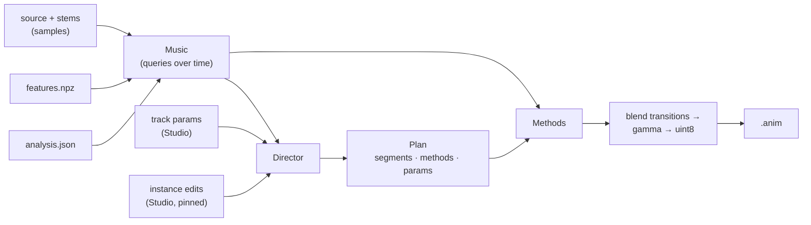

# Generators

Status: **working draft.** Design of `volu_gen/generators/`, replacing open
question 1 in `architecture.md`. Items marked *(proposed)* are defaults
until decided; questions still open are collected at the end.

Related: `architecture.md` (render job, storage), `ui.md` (Studio),
`decisions/0004-audio-analysis.md` (`analysis.json`),
`decisions/0010-display-fps.md`, `decisions/0011-planning-in-server.md`.

---

## Concept
The generator is a **director** that runs a set of **methods**. A method
is one way of animating the display from the music: rain, fireworks,
geometry, a 3D spectrogram, and so on. The director splits the track into
**segments** and picks a method (and that method's parameters) for each,
based on what the analysis knows about that part of the song. Calm parts
change rarely; high-energy parts change faster, per few bars or per bar.

Rendering is two steps:
1. **Plan.** The director reads the music data and writes a **plan**: a
   list of segments, each with a time range, a method, the method's
   params, and how it transitions in. The plan is plain data (JSON).
2. **Render.** Each segment's method renders its frames; the job blends
   transitions, converts colors, and writes the animation file.



Splitting plan from render is what makes editing possible. In v1 the user
edits the params of each **instance** of a method (each segment it runs
in) in Studio; the future manual editor also changes which method runs on
which beats, bars, or sections. Either way the edits are plan entries the
director keeps, so it never has to understand them.

## Methods
Each method declares what it suits (phrase types, energy range) so the
director can choose it, and **chooses its own base params** from the
segment it's given (BPM, energy, mood, phrase type). Kicks and bass should
drive most of them visibly.

| Method | Idea | Driven by (examples) |
|---|---|---|
| `spectrogram` | 3D spectrogram: frequency across x, amplitude as height, history scrolling back through the slices (z) | band spectrum; kick → flash of the newest slice |
| `raindrops` | A "sea" surface of pixels at some height; drops land and spread ripples | onsets spawn drops; kick → big drop; bass → swell height |
| `rain` | Falling streaks | density from energy; kick → gust or flash |
| `fireworks` | Launches, bursts into expanding shells that fall under gravity | snares/accents launch; kick → burst; drops → volley |
| `strobe` | Full display or alternating slices, on beats or subdivisions | beat grid; drops only by default (see Smoothness) |
| `static` | TV-style noise, colorful or black and white | bass → density / brightness |
| `geometry` | Basic shapes (cube, sphere, torus, …) spinning smoothly and moving around | kick → scale pulse; bass → glow |
| `galaxy` | Individual pixels as stars; slow rotation, spiral arms, twinkle | energy → rotation speed; kick → brightening |
| `landscape` | Procedural mountain range scrolling through the display, as if flying over land | energy → speed; bass → terrain pulse |
| `supernova` | Spinning explosion from the center, expanding shell and debris | drop → explosion; kick → shockwaves |
| `oscilloscope` | A stem's waveform drawn as a line. 2D: in one slice, or copied to every slice. 3D: each slice holds an older frame's waveform, so the waveform scrolls back through the volume as a surface. Variant: one stem per group of slices | samples of a chosen stem; kick → line brightness / thickness |
| `vectorscope` | Stereo shapes: left vs. right channel as x / y (rotated 45° to mid/side, as a goniometer does), with a trail receding through the slices. 3D variant: delay embedding, `(s(t), s(t−τ), s(t−2τ))`, gives Lissajous-like 3D shapes even from mono stems | samples of a chosen stem; stereo width → shape size; kick → flash |
| `model` *(deferred)* | Plays a hand-made 3D animation file, set manually | needs an import format (e.g. glTF) and voxelization |

Interface *(proposed)*:

```python
class Method(Protocol):
    id: ClassVar[str]                     # stable, e.g. "raindrops"
    version: ClassVar[int]                # bump when output changes for the same params
    Params: ClassVar[type[BaseModel]]     # per instance (segment); pydantic → JSON Schema
    suits: ClassVar[Suitability]          # phrase types, energy range, granularity

    @classmethod
    def choose_params(cls, seg: SegmentInfo, music: Music, rng) -> Params: ...

    def __init__(self, ctx: RenderContext, seg: SegmentInfo, params: Params): ...
    def render(self, start: int, stop: int) -> np.ndarray: ...   # float32 [n, P, 3]
```

- `render` works on **any frame range within the segment** (a little
  beyond it too, for transitions), vectorized over frames and pixels.
- `__init__` may precompute **cheap per-segment data**: particle spawn
  lists (time, position, size), the landscape's travelled distance (the
  integral of its speed over time), a star field. Each frame is then a
  closed-form function of time and that data, e.g. a ripple's radius is
  a function of time since its drop landed.
- No state carried frame to frame. This keeps segments independent: a
  transition can render two methods over the same frames, the manual
  editor can re-render one segment, and the deferred loop preview works.
  It rules out true simulations (fluids, reaction-diffusion); none of the
  methods above need one.
- Methods that read audio samples read only the requested range plus a
  declared look-back (e.g. the 3D oscilloscope's slice history), so they
  stay range-independent too.

**Waveform methods and smoothness.** Raw waveforms jitter and alias on a
sparse display, so `oscilloscope` and `vectorscope`:
- **trigger** like a real oscilloscope: align each frame's window to a
  rising zero crossing (or the pitch period), so a steady tone holds still
  instead of jumping between frames;
- **low-pass and resample** the window to the display's resolution before
  drawing (the prototype is 10 pixels wide: only ~10 points of waveform
  are visible), and draw the line with the usual soft falloff;
- **blend over a few frames** (short persistence, like phosphor), which
  also gives the vectorscope its trail.

Bass and kick stems are often near-mono, which collapses a left/right
vectorscope to a line; the director should prefer stems with stereo width
(a feature, below) or the delay-embedding variant.

## Director
**Segmenting** *(proposed)*:
- Start from the analysis phrases (8 bars from each section start and
  drop). Split further by energy: low energy keeps a method for a whole
  phrase or section; medium switches every 4 bars; high energy (drops)
  every 2 bars or every bar. Boundaries always land on the grid.
- **Per-beat changes happen inside a method**, not by switching methods
  (e.g. strobe alternating slices each beat, geometry swapping shapes on
  the beat). Per bar is the fastest the director switches methods.
- Variable-tempo tracks (no grid): segment by sections, use raw beats.

**Choosing a method** for a segment *(proposed)*:
- Inputs: phrase type, energy (per-bar mix energy, drums/bass on or off),
  mood, genre, position in the track, and what came before.
- Each method's `suits` gives it a score for the segment; the director
  picks by weighted random choice with a per-segment seed, and avoids
  repeating the previous segment's method.
- **Repeated parts pick freely.** A second drop gets no special link to the
  first; it is scored and chosen like any other segment.
- A **track palette** is chosen once from mood and genre and passed to
  every method, so method changes stay visually coherent.

**Phrase types.** The director uses the analysis as it is: `drop`,
`buildup`, `breakdown` tags, untagged phrases (the track's "groove"),
drums/bass events, and per-bar energy. No intro/outro tags are added;
those parts already read as low energy, drums or bass off, at the start or
end of the track.

**Transitions.** Chosen from how different two neighboring segments really
are, not one fixed rule:
- **Into a drop: always a hard cut** on the downbeat.
- Otherwise the director scores the **contrast** between the two segments
  *(proposed inputs)*: the energy jump (dB, per-bar mix energy), drums or
  bass switching on/off, a section boundary vs. a split inside a phrase,
  and a change of phrase tag.
- High contrast → a hard cut on the downbeat. Medium → a 1–2 beat
  crossfade (the baseline). Low (e.g. a split inside one phrase, same
  material) → a longer crossfade, up to a bar.
- The transition is part of each plan entry, so the editor can change it.

## Plan
```jsonc
{
  "director": { "version": 1, "params": { … } },        // track params
  "palette": [ … ],
  "segments": [
    { "start_bar": 1, "end_bar": 17, "start": 0.889, "end": 24.889,
      "method": "raindrops", "method_version": 1,
      "params": { "drop_size": 0.4, … },     // what choose_params picked
      "transition": { "kind": "cut" } },
    { "start_bar": 49, "end_bar": 57, …,
      "method": "raindrops",
      "params": { "drop_size": 0.4, … },
      "overrides": { "drop_size": 0.9 },     // user edit: this instance only
      "pinned": true,
      "transition": { "kind": "crossfade", "beats": 1 } }
  ]
}
```
- Deterministic: same analysis + features + track params + edits + seed +
  versions → same plan.
- **Instance edits** (v1): `overrides` holds only the fields the user
  changed; every other field stays automatic. A segment with overrides is
  **pinned**: re-planning (new track params or seed, a grid override)
  keeps its bars, method, and overrides, and plans the rest around it.
  Its automatic fields are re-chosen as usual.
- Segments are anchored by **bar numbers**, so they survive a grid
  override; `start`/`end` are recomputed from the grid.
- **Planning runs in the API server**, not as a worker job
  (`decisions/0011-planning-in-server.md`): it is pure Python over
  `analysis.json` and `features.npz` (milliseconds, no models), so Studio
  shows the new plan as soon as a track param or instance changes, without
  waiting behind analysis jobs. The render job is given the plan and
  renders exactly it. The version's DB row stores the track params and the
  plan; the `.anim` metadata carries a copy (`plan` key).
- Consequence: everything planning touches (the director, `Music`, each
  method's `Params` and `choose_params`) is imported by the server, so
  `generators/` keeps heavy imports (torch) out of module level.
- **Plans don't depend on the FPS.** Segments are in bars and seconds;
  the display FPS only enters at render time, so changing it re-renders
  the same plan.
- **Manual editor (deferred):** also change a segment's method,
  boundaries, and transition; those edits pin the segment the same way.

## Studio parameters (v1)
Two levels:

**Track params** — the director's, constant for the whole track:
- overall intensity / brightness
- change rate (how quickly segments switch, relative to the default)
- palette: from the track, or a user pick
- methods: which are enabled, and a weight for each (how often the
  director picks it)
- strobe max flash rate (default: the display maximum)
- seed (re-roll for a different plan)

**Instance params** — per use of a method. If `raindrops` runs in bars
1–17 and again in bars 49–57, each has its own drop size:
- Studio shows the plan as a **segment lane** above the stem lanes; each
  block is one instance, labeled with its method.
- Selecting a block opens that method's `Params` form, filled with the
  values `choose_params` picked. Changing a field overrides it for that
  instance only and pins the segment (Plan, above); changed fields are
  marked, and "reset" returns a field (or the whole instance) to
  automatic.
- The form is generated from the method's `Params` schema, so adding a
  param needs no UI code.

Presets save track params only. Instance edits belong to one track's plan
and are saved with its versions.

## Smoothness
Motion smoothness is a priority. The display is sparse (50 mm pitch), so
things must glide between pixels instead of popping:
- **Spatial:** never switch a pixel hard on/off at a shape's edge. Render
  every shape as a distance with a soft falloff about one pixel pitch
  wide, so a moving edge fades across pixels.
- **Temporal:** everything is a continuous function of time in seconds
  (not the frame index). Param changes ease in; envelopes have attack and
  release.
- **Hits:** a kick is a near-instant attack with a smooth decay
  (~100–300 ms): punchy without flicker.
- **Exceptions:** `static`, `strobe`, and star twinkle flicker on purpose.
  Strobe's max flash rate defaults to the display maximum: one on/off
  cycle per two frames at the render's FPS (30 / 60 / 120 flashes/s at
  60 / 120 / 240 FPS); the track param can lower it.
- **Dropped frames alias fast flicker.** A render played below its own
  FPS (decision 0010) drops frames, so a strobe at the render's maximum
  plays as solid on or off. The plan records its fastest strobe rate; a
  version whose rate is above half the current display FPS is flagged
  stale, like a render below the display FPS *(proposed)*.

## Inputs
**`Music`** — built once per render from `analysis.json`,
`features.npz`, and the audio; vectorized queries over an array of times:
beat and bar index and phase, the current section and phrase and its tags,
time since and until events, per-bar energy (interpolated), feature
envelopes, genre, mood, palette. It hides grid vs. variable tempo and the
user override. The raw `analysis.json` dict is available as an escape
hatch.

**Audio samples** — methods can read the actual waveforms *(proposed)*:
- `music.samples(stem, t0, t1)` → `[n, 2]` float32 stereo at 44.1 kHz,
  for `vocals`, `drums`, `bass`, `other` (`stems/*.flac`) or `mix`
  (`source.<ext>`).
- `music.frame_windows(stem, start, stop, length)` → `[frames, length, 2]`:
  the window of samples ending at each frame's time, the common case for
  waveform methods (a frame spans ~735 / ~367 / ~184 samples at
  60 / 120 / 240 FPS).
- Decoded once per render and cached in the render job: four stereo stems
  of a 4-min track are ~340 MB as float32, fine for the worker; decode per
  chunk if the large build makes this tight.
- Offline only: playback still reads just the animation file.

**`features.npz`** — needed from the start, since kicks and bass drive most
methods. A new CPU stage in analysis *(proposed)*:
- kick onsets and strength (drums stem, low band); snare/hat onsets (drums
  stem, higher bands) for accents
- envelopes per stem (RMS), unsmoothed
- a log-frequency band spectrum (~24 bands) **per stem and for the mix**,
  for `spectrogram` and for coloring by what a stem is doing
- stereo width per stem (side / mid energy), so the director can choose
  `vectorscope` and its stem
- at a fixed rate at least the highest display FPS (e.g. 240 Hz), so it
  is independent of the display FPS setting; `Music` resamples
- Methods use features where they can (cheap, precomputed) and raw
  samples where they need the waveform's shape.

**`RenderContext`** — pixel positions, fps (the display FPS the render was
queued at: 60, 120, or 240), frame count, `Music`, seed. Methods work in
seconds, never assume a frame rate, and look the same at any of the three:
- `pos`: normalized, centered, **y up** (rain and fireworks fall, the
  landscape has a ground), divided by the largest half-extent so aspect
  ratio is kept: a method written for the prototype fits the large build
- also `pos_mm` and integer `(ix, iy, iz)` per pixel plus slice parity, for
  methods that address slices or strips (alternating-slice strobe)

## Output and render job
- Methods return float32 linear RGB `[0, 1]`. The job blends transitions,
  clips, applies a fixed gamma, and quantizes to uint8 for the file.
- Global brightness and a power cap are applied at playback by the engine
  (adjustable live, like the sync offset) *(proposed)*.
- The job renders in animation-file chunks (1 s: `fps` frames), in order, and
  checks for cancel between chunks. A chunk that straddles a segment
  boundary asks both methods for their part.
- Randomness: a per-segment RNG seeded from `(seed, segment start bar)`,
  so re-planning or editing one segment doesn't reshuffle the others.
- Versions: the generator version covers the director; each plan entry
  records its method version. A render is stale if either changed.
- numpy on the CPU first; allow torch inside a method if a 20k-pixel render
  measures too slow. Methods are registered in a dict keyed by `id`.

## Build order
1. The `features` analysis stage.
2. `Music`, `RenderContext`, the director, the plan, and the render job.
3. First methods: `geometry`, `raindrops`, `strobe`, `galaxy` (they cover
   calm through drop).
4. The rest of the methods (including `oscilloscope` and `vectorscope`);
   `model` last.

## Settled
- Methods can read the stems' and mix's audio samples, not only features.
- Planning runs in the API server (decision 0011).
- Methods render at the display FPS (60 / 120 / 240, decision 0010) and
  must not assume a rate.
- Repeated parts (e.g. a second drop) pick freely, like any segment.
- Transitions depend on the contrast between neighboring segments, with a
  1–2 beat crossfade as the baseline; drops always cut hard.
- The Studio v1 form has track params, plus params per method instance
  (each segment a method runs in), edited from the segment lane.
- No intro/outro detection; the director uses the existing analysis.
- Strobe max flash rate defaults to the display maximum.
- Build order as above.

## Open questions
1. **Contrast score weights** for transitions: tune by eye once the
   director and the first methods exist.
2. **Other transition kinds** (flash, a wipe through the slices) beyond cut
   and crossfade: add if crossfades look flat.
